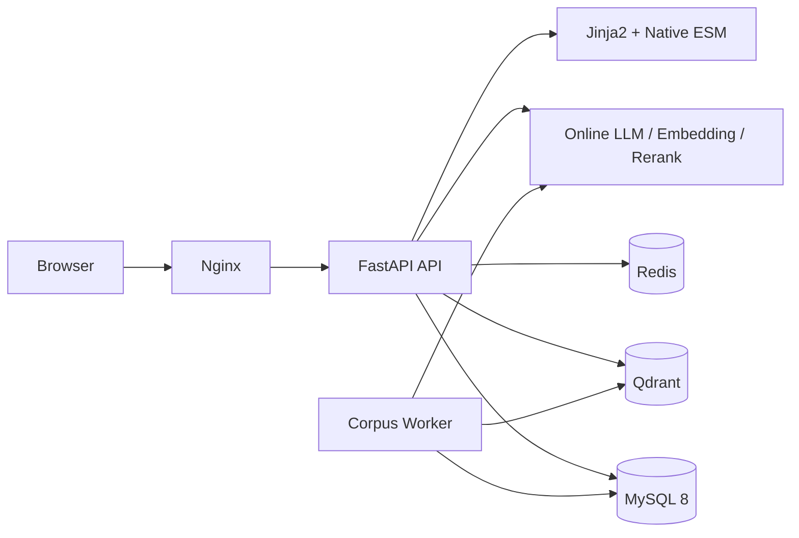
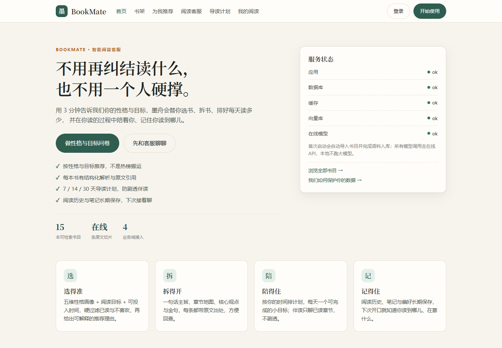
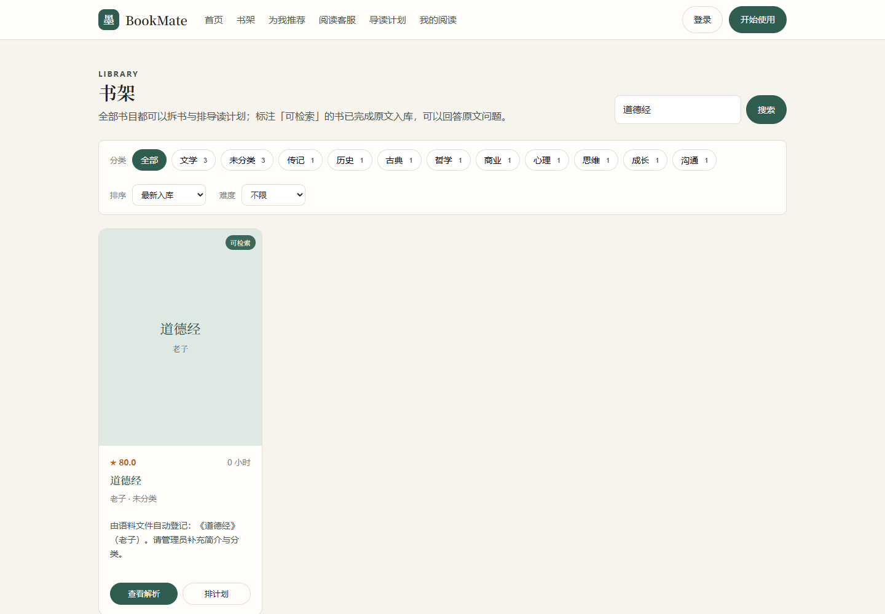
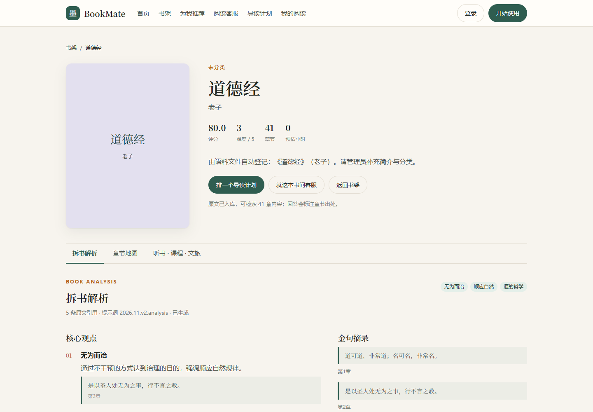
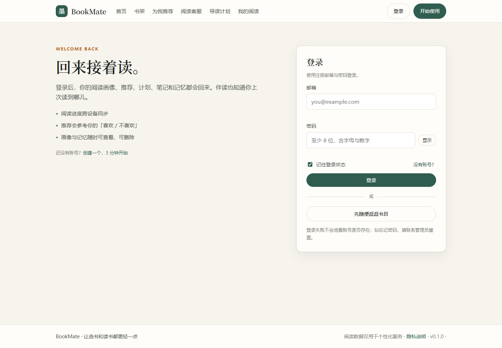
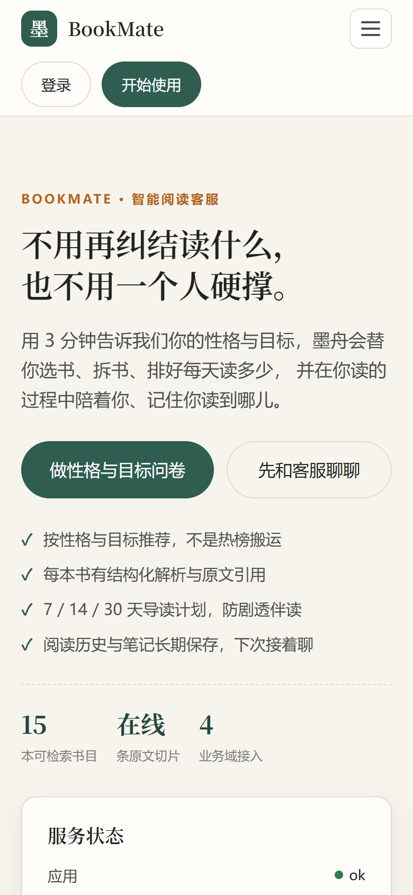

# 墨舟 BookMate

面向阅读场景的智能客服系统：根据性格与目标推荐书目，提供书籍解析、导读计划、伴读与阅读记忆，
并把听书、教育、文旅、金融四个业务域接入同一套客服编排。


## 能力概览

- **个性化推荐**：问卷画像 + 目标约束 + 反馈回流，输出可解释的推荐理由
- **RAG 问答**：章节切片、向量 + ngram 全文混合检索、RRF 融合、在线重排、引用与护栏
- **书籍解析**：核心观点、金句、论证结构、适读人群
- **导读与伴读**：按天排计划、打卡、笔记、进度与长期记忆
- **四域业务**：听书 / 教育 / 文旅 / 金融，失败自动降级，不阻断主流程
- **语料导入**：管理员后台上传 TXT / Markdown / 文字版 PDF，自动切片、向量化并接入检索
- **可观测性**：`/healthz`、`/readyz`、Prometheus 指标、审计日志与安全事件

## 架构



- 生产只暴露 Nginx，MySQL / Redis / Qdrant / API 均在 Docker 内网
- 模型全部走在线 API，不在本地加载权重；CPU / GPU 部署文件分离
- 语料入库幂等：内容哈希 + 章节/切片唯一键，重启不会重复向量化

## 界面预览

| 首页 | 书架 |
| --- | --- |
|  |  |
| **书籍解析** | **登录** |
|  |  |

移动端首页：



在线演示：<http://119.45.187.228:8080>（个人项目演示环境，模型调用有速率限制）

## 效果数据

RAGAS 黄金集 19 条，真实在线模型评测（`eval/reports/ragas_prompt_v2`）：

| 指标 | 分数 | 阈值 |
| --- | ---: | ---: |
| 忠实度 Faithfulness | 0.764 | 0.65 |
| 答案相关性 Answer Relevancy | 0.756 | 0.65 |
| 上下文精确率 Context Precision | 0.766 | 0.55 |
| 上下文召回率 Context Recall | 0.881 | 0.60 |
| 章节命中率 | 0.944 | — |
| 平均延迟 | 3005 ms | — |

完整明细见 [`bookmate/eval/`](bookmate/eval/)，评测方法见 [`Docs/开发手册.md`](Docs/开发手册.md)。

## 快速开始

```bash
cd bookmate
cp .env.example .env       # 填写 LLM / Embedding / Rerank Key 与管理员密码
docker compose --env-file .env -f deploy/compose/docker-compose.dev.yml up -d --build
```

打开 <http://127.0.0.1:8000>。生产部署使用
`deploy/compose/docker-compose.cpu.yml`，含 init 迁移、健康检查、烟雾测试与回滚点。

## 目录

| 路径 | 内容 |
| --- | --- |
| [`bookmate/`](bookmate/) | 可运行应用：FastAPI + MySQL + Redis + Qdrant + Nginx |
| [`bookmate/app/`](bookmate/app/) | API、业务服务、RAG、模型客户端、数据模型 |
| [`bookmate/web/`](bookmate/web/) | Jinja2 模板与原生 ESM 前端 |
| [`bookmate/eval/`](bookmate/eval/) | 黄金集与 RAGAS 评测产物 |
| [`Docs/`](Docs/) | 需求、开发手册、验收报告 |

## 本地质量门禁

```bash
cd bookmate
docker compose --env-file .env -f deploy/compose/docker-compose.dev.yml \
  exec -T api python -m pytest -q
docker compose --env-file .env -f deploy/compose/docker-compose.dev.yml \
  exec -T api python -m ruff check app tests
```

GitHub Actions 在每次 push / PR 时自动执行同一套 lint 与测试。

## 语料与版权

`bookmate/data/books/` 仅保留公有领域示例（《论语》《道德经》）。请勿上传未授权的
版权书籍；扫描版 PDF 需先 OCR 再导入。

## 文档

- [需求文档](Docs/需求文档.md)
- [开发手册](Docs/开发手册.md)
- [验收报告](Docs/验收报告.md)
- [协作与输入清单](Docs/协作与输入清单.md)

## License

[MIT](LICENSE)
